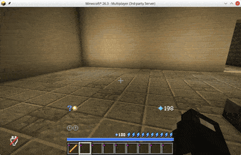
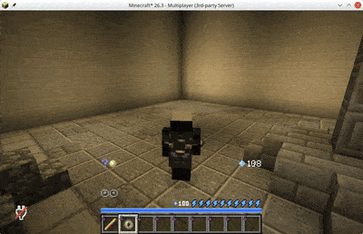
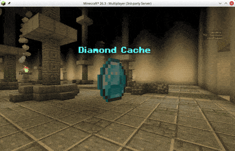
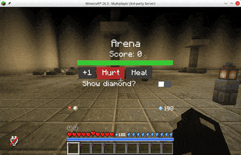
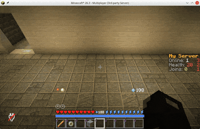
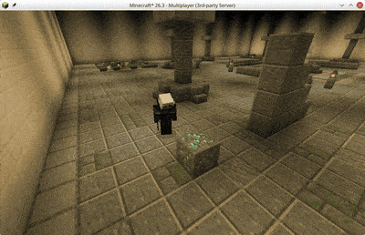

# PxIgnis


Lua scripting for Minecraft Fabric servers.

> This project is developed with the assistance of AI. Humans were harmed
> (and included) during development too.

[Full Docs](https://ignis.pyxiion.ru) · [Полная документация](https://ignis.pyxiion.ru/?lang=ru) · [Quick start](https://ignis.pyxiion.ru/guide/getting-started) · [Changelog](site/src/content/docs/changelog.md)

---

## Examples

Every script is a plain `.lua` file in `config/ignis/`; `/ignis reload` applies it without a restart.

### Thunder staff

Right-click a blaze rod: lightning strikes where you look.



```lua
mc.on("player.use_item", function(e)
    if e.itemId ~= "minecraft:blaze_rod" then return end

    local hit = e.player:raycast(60)
    if hit and hit.type == "block" then
        e.player.world:strike(hit.hit)
        e.player:setCooldown("minecraft:blaze_rod", 20)
    end
end)
```

### Blink

Teleport to the block you look at, with a particle burst on both ends.



```lua
local portal = particle("reverse_portal")

mc.on("player.use_item", function(e)
    if e.itemId ~= "minecraft:ender_eye" then return end

    local p = e.player
    local hit = p:raycast(40)
    if not (hit and hit.type == "block") then return end

    local from, to = p.pos, hit.hit
    p.world:emit(portal, from, { count = 60, spread = 0.4 })
    p:teleport(to.x, to.y, to.z)
    p.world:emit(portal, to, { count = 60, spread = 0.4 })
    p:playSound("minecraft:entity.enderman.teleport", 1, 1.2)
end)
```

### Floating loot with a hologram

`/cache` drops a spinning, bobbing diamond with a label where you look. Display entities are packet-only: no entity lag, and they vanish on their own.



```lua
local display = require "core:display"
local async = require "async"

register("cache", function(ctx)
    local p = ctx.player
    local hit = p:raycast(6)
    local spot = (hit and hit.hit or p.pos) + vec(0, 1.5, 0)
    local gem = display.item(p.world, spot, "minecraft:diamond", { scale = 1.5, mode = "fixed" })
        :spin({ 0, 1, 0 }, 80)
        :life(400)
    display.text(p.world, spot + vec(0, 0.8, 0), "§b§lDiamond Cache"):life(400)

    async.task(function()
        while gem.valid do
            gem:flyTo(spot + vec(0, 0.3, 0), 40)
            async.sleep(40)
            gem:flyTo(spot, 40)
            async.sleep(40)
        end
    end)
end)
```

### In-world UI panel

`/panel` puts a clickable panel in front of you: hover highlights, buttons play sounds, the bar and counter follow reactive refs.



```lua
local ref = require "core:ref"
local ui = require "core:ui3d"

register("panel", function(ctx)
    local p = ctx.player
    local d = p.dir
    local len = math.sqrt(d.x * d.x + d.z * d.z)
    local fx, fz = d.x / len, d.z / len
    local facing
    if math.abs(fx) > math.abs(fz) then facing = fx > 0 and "west" or "east"
    else facing = fz > 0 and "north" or "south" end

    local score = ref.new(0)
    local hp = ref.new(1.0)
    local toggle = ref.new(false)

    ui.panel {
        at = vec(p.pos.x + fx * 3, p.eyePos.y, p.pos.z + fz * 3),
        facing = facing, width = 3, height = 1.6, world = p.world,
    } {
        ui.col { gap = 0.06, pad = 0.12,
            ui.text { "Arena", size = 0.25 },
            ui.text("Score: %s", score),
            ui.bar { value = hp, h = 0.14 },
            ui.row { gap = 0.06,
                ui.button { "+1", onClick = function() score:inc() end },
                ui.button { "Hurt", style = "danger",
                    onClick = function() hp:update(function(v) return math.max(0, v - 0.2) end) end },
                ui.button { "Heal", onClick = function() hp:set(1.0) end },
            },
            ui.row {
                ui.text { "Show diamond? ", align = "left", grow = true },
                ui.toggle { value = toggle }
            },
            ui.each({1, 2, 3}, function(i)
                return ui.show(toggle, ui.text { "HELLO #" .. i .. "!!!", ui.icon "minecraft:diamond" } )
            end),
        },
    }
end)
```

### Live scoreboard

A per-player sidebar that updates every second; the loop is a coroutine, so waiting is just `async.sleep`.



```lua
local async = require "async"

async.task(function()
    while true do
        for _, p in ipairs(mc.players) do
            p.sidebar = {
                title = "§6§lMy Server",
                lines = {
                    "§7Online: §f" .. #mc.players,
                    "§7Health: §c" .. math.floor(p.health),
                    "§7Joins: §a" .. (p.data.joins or 0),
                },
            }
        end
        async.sleep(20)
    end
end)
```

### Lucky ore

Break a diamond ore: fireworks of totem particles and a title.



```lua
local totem = particle("totem_of_undying")

mc.on("block.break", function(e)
    if e.block == "minecraft:diamond_ore" then
        e.player:sendTitle({ title = "§bLucky!" })
        e.player.world:emit(totem, e.pos, { count = 80, spread = 0.6, speed = 0.4 })
    end
end)
```

### Commands and persistent data

Typed arguments, tab completion and permissions come from the signature; `player.data` is saved to disk.

```lua
register("pay <amount:int> <target:player>", function(ctx, amount, target)
    ctx.player.data.balance = (ctx.player.data.balance or 0) - amount
    target.data.balance     = (target.data.balance or 0) + amount
    target:sendMessage("Received " .. amount .. " from " .. ctx.player.name)
end, "px.ignis.pay")
```

---

## What's inside

| Area          | What you get                                                                                                               |
|---------------|----------------------------------------------------------------------------------------------------------------------------|
| **Commands**  | Brigadier with tab completion, permissions, and types (`text`, `word`, `player`, `int`, `bool`, `block_pos`, `choice=...`) |
| **Events**    | Players, entities, blocks, items, server lifecycle                                                                         |
| **Reload**    | `/ignis reload` re-executes all scripts; persistent state via `mc.data` / `player.data`                                    |
| **MC API**    | Particles, sounds, blocks, entities, NBT, structures, weather, world border, explosions                                    |
| **UI**        | Per-player sidebar, chest GUI lib, boss bars, holograms, titles                                                            |
| **Async**     | `require "async"`: `async.fetch()` for HTTP, `async.sleep()` for delays, tasks, `async.parallel` for heavy calculations |
| **Storage**   | Per-player and global JSON-backed key-value tables                                                                         |
| **Packages**  | Folders with an `ignis.json` manifest: dependencies, load order, `require("pkg:id")`; Kotlin plugins add `ext:` modules   |
| **Voice**     | `ignis-voice` plugin: play `.ogg`/`.wav` to players through Simple Voice Chat, no resource pack                            |
| **Dev tools** | LuaLS types for IntelliSense, `mc.dump()`, metatable extension hooks                                                       |

## Install

Minecraft 1.21.x · Fabric Loader ≥0.19.2 · Fabric API ≥0.141.4 · Fabric Language Kotlin ≥1.10.8

1. Drop the mod into `mods/`.
2. Start the server — `config/ignis/demo.lua` is created.
3. Edit scripts, run `/ignis reload` (OP-4 or `px.ignis`).

Optional: put `ignis-voice` (a separate jar) next to it for [custom audio](https://ignis.pyxiion.ru/reference/voice/); players need Simple Voice Chat.

## License

GNU Lesser General Public License v3.0. See [LICENSE.txt](LICENSE.txt).
