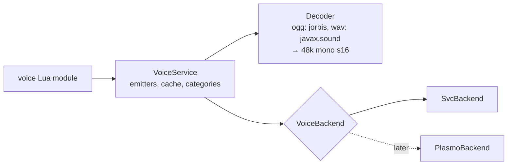

# ignis-voice: custom audio through voice chat mods

Status: implemented in `plugins/voice` (v1). Reference: `site/src/content/docs/reference/voice.md`. Plugin framework: [plugins.md](./plugins.md).

The server sends custom audio files to players through their voice chat mod, so no resource pack is needed. Players
without a voice mod do not hear these sounds; `voice.canHear(p)` lets scripts fall back to vanilla sounds.

## Scope v1

- Plays `.ogg` (Vorbis) and `.wav` files only. No microphone interception, groups or voice zones yet (phase 2).
- Backend: Simple Voice Chat only, behind a `VoiceBackend` abstraction so Plasmo Voice can be added later without API
  changes.
- Out of scope: seek, fades, mp3.

## Lua API (`require("ext:voice")`)

```lua
local voice = require("ext:voice")

voice.backends            -- {"svc"}: installed backends; empty means nobody can hear anything
voice.canHear(player)     -- true if the player is connected to some backend

-- Volume category: a client-side slider. Declare it in the script; it is re-registered on reload.
voice.category{ id = "music", name = "Music", description = "...", icon = "icons/music.png" }

-- Sound: returns at once and never yields.
local boss = voice.load("sounds/boss.ogg")
boss.ready  boss.error  boss.duration
boss:onReady(function(s) end)   -- runs on the server thread
boss:await()                    -- yields; only inside coroutines (handlers/async), errors in the script root

-- Emitter: a long-lived source.
local radio = voice.emitter{
  entity = npc,                 -- or pos = vec, world = w  /  or players = { p1, p2 } (non-spatial)
  distance = 32,
  category = "music",
  volume = 0.8,
  listeners = function(p) return p:hasTag("radio") end,  -- or a list; re-evaluated about once per second
}
radio:play(boss, { loop = false })   -- replaces the current track
radio:queue(other)
radio:stop()
radio.entity = otherNpc             -- move the source
radio.playing  radio.position       -- position in seconds
radio:onEnd(function() end)         -- the queue ran out
radio:close()

-- Fire-and-forget: sugar for a temporary emitter that closes itself at the end.
local h = voice.play(boss, { pos = vec, world = w, distance = 16, category = "music" })
h:stop()
```

### Rules

- **No yields in `load`, `play` or `emitter`.** The script root runs outside a coroutine (`IgnisRuntime` calls the
  loaded chunk directly), so any API meant for the script root must not yield. `await` is a separate method used only
  in coroutines.
- `play` on a sound that is not ready yet creates the player and starts playback once decoding finishes. On a sound
  that failed to decode it raises an error for that call; the decode error itself is reported once through
  `ScriptErrors`.
- The source keys are `entity`, `pos` + `world`, and `players`, and exactly one must be given. Mixing them or giving
  none is an argument error.
- An emitter attached to an entity stops when that entity is removed.
- Volume is applied by scaling the PCM ourselves, because SVC has no per-source volume.
- On reload, `env.onClose` stops all emitters and cancels pending decodes. The decoded-audio cache (keyed by path and
  mtime) survives the reload.
- Paths resolve against the calling package's folder, or against the script root for loose scripts (see
  [plugins.md](./plugins.md)).

## Kotlin structure



- `VoiceBackend`: `id`, `installed`, `canHear(player)`, `registerCategory(id, name, desc, icon: BufferedImage?)`,
  `unregisterCategory`, `openChannel(source, distance, category, audience): Channel?`. A `Channel` is pulled, not
  pushed: `start(frames: FrameSource)` makes the backend call `FrameSource.next()` at real-time pace on its own thread
  (960-sample frames, 48 kHz, mono, 16-bit, 20 ms, the common format of SVC and PV; null ends playback),
  `update(source, audience)`, `stop()`, `close()`. `audience` is the set of player UUIDs that should hear it (null:
  everyone in range), computed on the server thread from `listeners` once a second.
- If several backends are installed, an emitter opens one channel on each, and each delivers to its own clients. The
  channels read the same frames from a short ring, so they stay in step.
- Backend classes load only when their mod is present (`FabricLoader.isModLoaded`), declared in `suggests`.
- SVC: the `voicechat` entrypoint (`SvcPlugin` hands its server API to `SvcBackend`), `voicechat-api:2.6.27`. Locational, entity and static channels (static ones address the audience through `addTarget`);
  `createAudioPlayer(channel, encoder, Supplier<short[]>)` paces playback on its own thread. Categories come from
  `volumeCategoryBuilder` with a 16×16 ARGB icon.
- Decoding runs on `env.scope` (the mod scope) on `Dispatchers.IO`, one job per `load`, cancelled by `onClose`. Short files are decoded fully and cached. Long files (over 30 s) stream frame by frame
  through the supplier. The resampler (to 48 kHz) and the stereo downmix are written by us. Vorbis goes through `jorbis` (it includes
  `jogg`; no `vorbisspi`), shaded and relocated to `ru.pyxiion.lib.jcraft`. WAV uses `javax.sound`, which needs `java.desktop` in the
  server JVM (SVC needs it too).
- The supplier thread never touches Lua: `onEnd` and similar callbacks are sent back through `env.runOnServer`.
